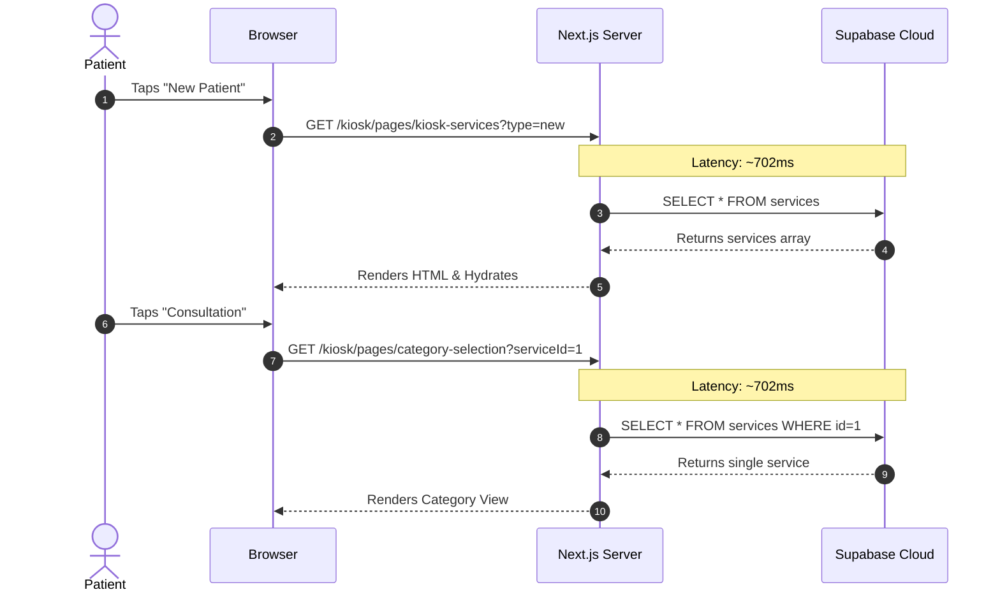
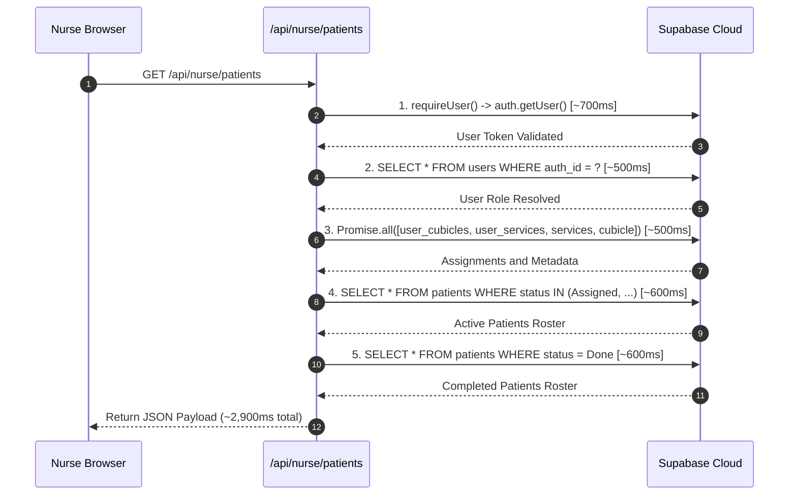

# Heart Check PHC: Performance Audit and Latency Solutions Guide

## Executive Summary

This specification provides a comprehensive audit of data fetching and interaction latency across the **Kiosk**, **Nurse Station**, and **Transfer Dashboard** modules in the Heart Check PHC queue management system.

### Measured Network Baseline
Direct timing diagnostics from the local host to Supabase Cloud (`ewpvlsbbmkxuahhaezvo.supabase.co`):
- **DNS Resolution:** 96 ms
- **TCP Connection:** 147 ms
- **TLS Handshake:** 220 ms
- **Server Response (TTFB):** 702 ms per single request
- **Local Docker Equivalent:** 0.3 ms TCP / 30 ms TTFB

The system latency is not driven by payload size (operational payloads are typically < 1 KB to 5 KB). Instead, it is caused by **compounding network round trips (request waterfalls)** and **re-fetching customizable configuration data on every click and navigation**.

---

## Architecture Problem Matrix

| Module | Observed Symptom | Primary Root Cause | Cloud Latency Cost |
| :--- | :--- | :--- | :--- |
| **Kiosk** (`/kiosk/*`) | 1 to 2 second delay between touching screen buttons | 6 independent Next.js Server Component routes re-querying `services` and `cubicle` on every step transition | 700 ms - 1,200 ms per screen tap |
| **Nurse** (`/nurse`) | Initial spinner lasts 2.5 - 3.5 seconds; clicks feel lagged | `/api/nurse/patients` executes 5 sequential database/auth queries; client also queries `cubicle` and `doctors` | 2,500 ms - 3,500 ms per load |
| **Transfer** (`/transfer`) | Heavy CPU and network uplink load; delayed drag/drop | 17 concurrent hooks on mount; `usePatientData` executes up to 6 SQL `UPDATE` queries inside `fetchData()`, triggering Realtime echo loops | Continuous 500 ms - 1,500 ms background churn |
| **Monitor** (`/monitor`) | Audio announcements delay before speaking | `useMonitorData.ts` pauses to query `cubicle` synchronously over network before starting speech playback | 700 ms delay before speech |
| **Cross-Cutting** | Customization re-queries | 22 files independently query `from('services')` and 16 files query `from('cubicle')` on every mount | Multiplied by 700 ms per query |

---

## Detailed Root Cause Analysis

### 1. Kiosk Workflow: Multi-Route Waterfall

The Kiosk flow is divided into sequential URL routes:
1. `/kiosk/pages/kiosk-new-old-selection`
2. `/kiosk/pages/kiosk-services`
3. `/kiosk/pages/category-selection`
4. `/kiosk/pages/kiosk-cubicle-selection`
5. `/kiosk/pages/sms-input`
6. `/kiosk/pages/queue-print`



#### Flaw:
Because services and categories are stored in the database for Superadmin customization, the server components assume they change every second. Patients experience a 700ms to 1,200ms blank/loading freeze on every single touch.

---

### 2. Nurse Workstation: 5-Stage Sequential Waterfall

Inside [`app/api/nurse/patients/route.ts`](file:///home/jensen/Github-Repositories/heart-check-phc/app/api/nurse/patients/route.ts):



#### Flaw:
Running authentication checks, role resolution, facility assignments, active queue fetching, and finished queue fetching in series locks the workstation into a 2.5 to 3.5 second initial load.

---

### 3. Transfer Dashboard: The "Write-on-Read" Echo Loop

In [`app/transfer/hooks/usePatientData.ts`](file:///home/jensen/Github-Repositories/heart-check-phc/app/transfer/hooks/usePatientData.ts#L89-L123) and lines 278-320:

```typescript
// Executed on every fetchData() invocation:
const activeRegServices = await fetchRegistrationServices(); // Query 1
const occupiedCounters = await fetchOccupiedCounters();     // Query 2 (calls route with 4 DB queries)

// Executes writes back to database during a read operation:
if (w.progressIds.length) jobs.push(table().update(...));
if (w.statusIds.length) jobs.push(table().update(...));
for (const r of w.registration) jobs.push(table().update(...));
if (w.clearRegistration.length) jobs.push(table().update(...));
if (w.topIds.length) jobs.push(table().update(...));
if (w.clearTopIds.length) jobs.push(table().update(...));
await Promise.allSettled(jobs);
```

#### Flaw:
1. `fetchData()` performs multiple queries to compute registration timers and counter assignments.
2. It pushes up to 6 `UPDATE` statements to the `patients` table.
3. Supabase emits Realtime `postgres_changes` events to all connected clients.
4. The client's subscription hook catches the event and triggers `fetchData()` again.
5. Even with a 4-second throttle, this saturates network bandwidth and causes UI stutters during patient drag-and-drop operations.

---

### 4. Monitor Audio Playback Delay

In [`app/monitor/hooks/useMonitorData.ts:93-96`](file:///home/jensen/Github-Repositories/heart-check-phc/app/monitor/hooks/useMonitorData.ts#L93-L96):

```typescript
const destination = item.patient?.cubicleNum ?? item.cubicle;
if (destination) {
  // Synchronous network fetch right before speaking!
  const { data: station } = await supabase.from('cubicle').select('id')
    .eq('cubicleNum', destination).eq('on_break', false).maybeSingle();
  if (!station) continue;
}
// Speech only starts after network query finishes:
await playMonitorSpeech(item.message, 3, controller.signal);
```

#### Flaw:
The TV monitor pauses playback and queries the `cubicle` table over the internet before speaking. If the network has high latency, the callout sound is delayed by 700 ms.

---

## Architectural Solutions & Implementation Blueprint

```
+-----------------------------------------------------------------------------------+
|                        SYSTEM-WIDE OPTIMIZATION BLUEPRINT                         |
+-----------------------------------------------------------------------------------+
| 1. Metadata Cache Layer     --> Cache services/cubicles/counters in memory (0ms)  |
| 2. Kiosk State Controller   --> Single-screen client transitions (0ms taps)       |
| 3. Nurse Route Consolidation--> Parallelize auth and use selective SQL columns    |
| 4. Transfer Read Purity     --> Remove SQL mutations from fetchData()             |
| 5. Optimistic UI Updates    --> Immediate 0ms visual feedback on clinical clicks  |
+-----------------------------------------------------------------------------------+
```

---

### Solution 1: Shared Configuration Metadata Cache

Create a centralized, in-memory cache for facility customization data (`lib/cache/facilityMetadataCache.ts`).

#### Architecture:
- Services, cubicles, counters, and doctors rarely change during daily operations.
- Cache these objects in client memory with a 60-second to 5-minute TTL.
- Listen to a single Supabase Realtime broadcast channel (`customization-updated`) so that when a Superadmin saves changes in the Customization panel, the cache invalidates instantly.

#### Target Implementation:
```typescript
/**
 * @fileoverview In-memory cache for customizable hospital configuration metadata.
 */
interface CacheEntry<T> {
  data: T;
  timestamp: number;
}

const cache = new Map<string, CacheEntry<unknown>>();
const DEFAULT_TTL_MS = 180_000; // 3 minutes

export async function getCachedServices(supabaseClient: any, forceRefresh = false): Promise<any[]> {
  const cached = cache.get('services');
  if (!forceRefresh && cached && Date.now() - cached.timestamp < DEFAULT_TTL_MS) {
    return cached.data as any[];
  }

  const { data } = await supabaseClient
    .from('services')
    .select('id, label_en, key, display_order, patient_type, requires_nurse, requires_registration, requires_cubicle, has_subcategories, queue_prefix, queue_pad_length')
    .order('display_order', { ascending: true });

  if (data) {
    cache.set('services', { data, timestamp: Date.now() });
  }
  return data || [];
}

export function invalidateFacilityCache(key?: 'services' | 'cubicles' | 'counters') {
  if (key) cache.delete(key);
  else cache.clear();
}
```

#### Benefit:
Eliminates 22 duplicate cloud queries across components; returns customization data in **0 ms**.

---

### Solution 2: Zero-Latency Kiosk Transitions

Convert Kiosk step navigation to use cached client-side transitions rather than multi-page server component navigations.

#### Approaches:
1. **Option A (Preferred - In-Memory Stepper):**
   - The main `/kiosk` page loads `services` and `cubicles` once on initial mount.
   - Touching "New" -> "Consultation" -> "Adult" -> "Cubicle 1" updates local React state (`currentStep: 1 -> 2 -> 3 -> 4`).
   - Transition latency drops from **1,000 ms to 0 ms**.
   - Network communication is restricted strictly to the final step: calling `create_patient` when the ticket prints.

2. **Option B (Next.js Link Prefetching):**
   - If keeping separate routes, wrap navigation in `next/link` with `prefetch={true}` and convert page components to client components consuming the metadata cache.

---

### Solution 3: Decouple Derived Writes in Transfer Dashboard

In [`app/transfer/hooks/usePatientData.ts`](file:///home/jensen/Github-Repositories/heart-check-phc/app/transfer/hooks/usePatientData.ts):

1. **Remove `persistDerivedFields()` from `fetchData()`:**
   - A read operation must never mutate the table it is reading.
   - When a patient moves into registration or assigned status, perform the mutation explicitly at the event handler level (drag end or drop action) rather than during queue polling.
2. **Move Automatic Progression to Database Triggers:**
   - Setting `progress_started_at` when a patient becomes active should occur inside a PostgreSQL trigger on `status` change, not via browser HTTP queries.
3. **Cache Registration Services and Counters:**
   - Replace the 5-second polling of `/api/workstation/occupied-counters` with cached counter occupancy updated only on Realtime counter state change events.

#### Benefit:
Stops the background WebSocket echo loop and eliminates 6 concurrent database update jobs during routine reads.

---

### Solution 4: Nurse Workstation Route Optimization

In [`app/api/nurse/patients/route.ts`](file:///home/jensen/Github-Repositories/heart-check-phc/app/api/nurse/patients/route.ts):

1. **Consolidate Auth and Profile Lookups:**
   Combine the `requireUser` check and the `users` role query into a single database RPC or query using Supabase session claims.
2. **Select Specific Columns:**
   Replace `select('*')` on patients:
   ```typescript
   // Fast, lean query payload:
   .select('id, patientNum, status, cubicleNum, service, subcategory, queue_position, priority, created_at, consultation_started_at, carryout_started_at, reg_end')
   ```
3. **Parallelize All Queries via Promise.all:**
   Execute user assignment lookups, active patient queues, and finished patient rosters concurrently.
4. **Client-Side Optimistic UI:**
   In [`app/nurse/hooks/useNurseActions.ts`](file:///home/jensen/Github-Repositories/heart-check-phc/app/nurse/hooks/useNurseActions.ts), ensure that clicking "With Doctor" or "Carryout" immediately updates the local React roster (0 ms visual feedback), dispatching the network fetch in the background.

---

### Solution 5: Monitor In-Memory Cubicle Lookup

In [`app/monitor/hooks/useMonitorData.ts:93`](file:///home/jensen/Github-Repositories/heart-check-phc/app/monitor/hooks/useMonitorData.ts#L93):

- Remove `await supabase.from('cubicle').select('id')` from inside `processQueue()`.
- Use the already-loaded `stations` state array that the monitor maintains in memory.
- Check station break status synchronously:
  ```typescript
  const station = stations.find(s => s.cubicleNum === destination && !s.on_break);
  if (!station) continue;
  ```
- **Benefit:** Audio announcements play immediately without a 700 ms network pause.

---

## Phased Implementation Roadmap

```
Phase 1: Zero-Risk Quick Wins (No Schema Changes)
+-- 1. Add facilityMetadataCache.ts with 3-minute TTL for services and cubicles.
+-- 2. Replace monitor synchronous cubicle fetch with in-memory array check.
+-- 3. Restrict SELECT queries in /api/nurse/patients to needed columns only.

Phase 2: Workstation Optimization
+-- 4. Decouple persistDerivedFields from usePatientData.ts in Transfer.
+-- 5. Ensure Nurse workstation action clicks use 0ms optimistic UI state.
+-- 6. Cache user role and assigned cubicles in Transfer and Nurse sessions.

Phase 3: Kiosk Flow Optimization
+-- 7. Switch Kiosk navigation to client-side state transitions or prefetched routes.
```

---

## Conclusion

The observed delays are structural rather than network capacity limits:
1. Re-fetching customizable metadata that changes infrequently causes unnecessary cloud round trips.
2. Background writes during read cycles create network contention.
3. Replacing repetitive queries with in-memory caching and applying optimistic UI updates will make Kiosk, Nurse, and Transfer interactions feel instantaneous (< 50 ms) regardless of connection speed.
